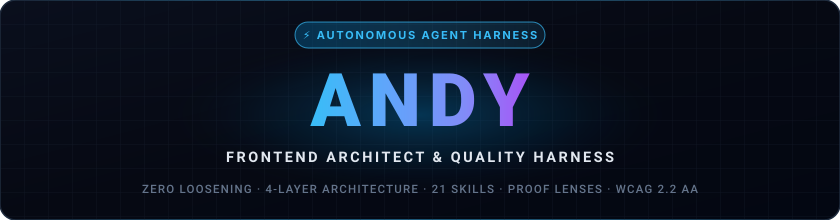
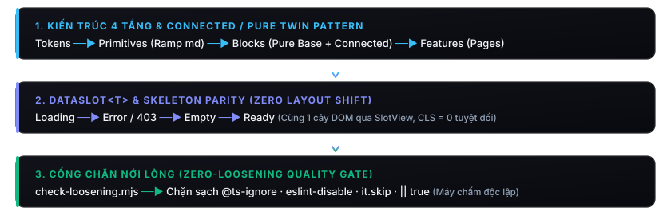

<div align="center">

<p align="center">
  
</p>

<p align="center">
  <strong>Bộ khung gầm kỹ thuật (Quality Harness) biến AI Coding Agents thành Senior Frontend Architect.</strong><br/>
  <em>Dành riêng cho Claude Code · Google Antigravity · Gemini CLI · Codex</em>
</p>

<p align="center">
  <a href="#tại-sao-cần-andy"></a>
  <a href="#vũ-khí-kiến-trúc"></a>
  <a href="#kỷ-luật-cổng-thép"></a>
  <a href="#21-skills-directory"></a>
  <a href="#cài-đặt-trong-30-giây"></a>
</p>

</div>

---

### Tại sao bạn cần Andy?

Bao nhiêu lần bạn giao việc cho Claude Code hay Cursor, để rồi nhận lại:
1. Một file component 700 dòng nhét đủ thứ từ API fetch, state, HTML đến CSS inline?
2. Khi gặp lỗi TypeScript hay linter, Agent **lén chèn `// @ts-ignore` hoặc `/* eslint-disable */`** để qua mặt bạn?
3. Giao diện khi load dữ liệu thì giật cục, nhảy layout lung tung (CLS), phím Tab không bấm được, modal mở lên mất focus?
4. Agent luôn miệng bảo: *"I have updated the code, it should work now!"* — nhưng chạy thử thì gãy tanh bành?

> **Andy sinh ra để chấm dứt toàn bộ những trò hề đó.**  
> Nguyên tắc bất biến: **Đứa viết ra code KHÔNG BAO GIỜ là đứa tự chấm điểm.**

---

### Xem Code thực tế: AI thường vs AI có Andy Harness

#### ❌ Code AI thường hay sinh (Spaghetti & Lách luật)
```tsx
// UserProfile.tsx — 1 file ôm đồm, lén lách TypeScript, giật layout khi tải
export function UserProfile({ id }: { id: any }) {
  // eslint-disable-next-line react-hooks/rules-of-hooks
  const [data, setData] = useState<any>(null);
  const [loading, setLoading] = useState(true);

  useEffect(() => {
    fetch(`/api/users/${id}`).then(res => res.json()).then(d => {
      setData(d);
      setLoading(false);
    });
  }, [id]);

  // @ts-ignore — Lén bỏ qua lỗi type
  if (loading) return <div className="animate-pulse h-40 bg-gray-200" />; // Gây nhảy layout (CLS)

  return <div style={{ padding: 17 }}><h3>{data.name}</h3></div>;
}
```

#### ✅ Code chuẩn Senior khi có Andy Harness (Connected/Pure Twin + DataSlot)
```tsx
// 1. component.tsx — Pure UI: Nhận atoms, exhaust switch trên Shape, test độc lập ở Storybook
export const UserProfileBase = (props: UserProfileBaseProps) => (
  <SlotView
    slot={props.props.userSlot}
    placeholder={USER_PLACEHOLDER}
    render={(user, isLoading) => (
      <Card className="p-4 flex flex-col gap-2">
        <UserAvatar src={user.avatarUrl} isLoading={isLoading} />
        <Heading rank={3} isLoading={isLoading}>{user.fullName}</Heading>
        {isLoading ? null : <RoleBadge role={user.role} />}
      </Card>
    )}
  />
);

// 2. index.tsx — Connected: Chỉ lo data fetching & handlers, truyền atoms xuống Base
export const UserProfile = ({ userId }: { userId: string }) => {
  const { data, error, isValidating } = useUserSwr(userId);
  const userSlot = slotOfSwr({ data, error, isValidating });

  return <UserProfileBase props={{ userSlot }} on={{ onRetry: () => mutate() }} />;
};
```
*Kết quả: **0% Layout Shift (CLS = 0)** vì skeleton dùng chung 1 cây DOM với data thật; **0 dòng `any`**; kiểm thử được trên fixture mà không cần mock API.*

---

### 3 "Vũ Khí" Kỹ Thuật Cốt Lõi

<p align="center">
  
</p>

#### 1. Connected / Pure Twin Pattern
Mỗi widget phức tạp được phân tách cơ học:
- **`component.tsx` (`XBase`)**: Chỉ nhận atoms và callbacks. Không gọi bất kỳ React Hook chạm thế giới bên ngoài (`useRouter`, `useSWR`, `useTranslation`). Nhờ vậy, UI có thể render và test bằng Storybook fixture trong 1 giây.
- **`index.tsx` (`X`)**: Chỉ làm nhiệm vụ kết nối thế giới bên ngoài (API, Store, Router) và map dữ liệu thành atoms truyền xuống Base.

#### 2. DataSlot<T> & Triệt Tiêu Nhấp Nháy (Skeleton Parity)
Thay vì tự bịa thẻ skeleton loading linh tinh gây giật khung hình:
- Trạng thái dữ liệu được đóng gói chặt chẽ: `{ isLoading } | { isError } | { isForbidden } | { isEmpty } | { items }`.
- Công thức `SlotView` render hàm `render(placeholder, true)` khi đang tải. Toàn bộ typography, khoảng cách, chiều cao được giữ nguyên vẹn 100% so với khi có dữ liệu thật.

#### 3. Kỷ Luật Cổng Thép (Zero-Loosening Gate)
Andy đi kèm script kiểm tra tự động quét 9 pattern lách luật thường gặp nhất ở AI:
```bash
node skills/fe-andy/scripts/check-loosening.mjs
```
*Nếu phát hiện bất kỳ dòng `@ts-ignore`, `eslint-disable`, `it.skip` hay `|| true` nào mà chưa khai báo lý do ở cấp dự án, bài kiểm tra sẽ đánh trượt ngay lập tức.*

---

### Hội thoại thực tế: Cách Andy làm việc cùng bạn

Andy không "thưa gửi rườm rà", Andy nói chuyện như một Senior Dev ngồi ghế bên cạnh:

```text
Bạn: "Andy, nút thanh toán trên trang checkout mobile đang bị lệch."

Andy:
"Mình soi thấy 2 vấn đề ở `src/features/checkout/PaymentAction.tsx:42`:
 1. Nút đang ăn class `h-8` (step `sm`) nằm chung hàng với input `h-10` (step `md`), làm gãy đường gióng ngang.
 2. Vùng bấm thực tế chỉ có 32px, vi phạm Touch Floor 44px của mobile.

Giải pháp:
 - Snap nút về step `md` theo Control-Height Ramp.
 - Thêm pseudo-element `:after` mở rộng vùng bấm vô hình lên 44px.
 - Không làm phình chiều cao nút thật.

Diff dự kiến 4 dòng. Bạn gõ 'go' là mình sửa và verify ngay."
```

---

### 21 Kỹ Năng Rành Mạch (Skills Directory)

Andy tự động chọn đúng skill theo intent của bạn, không bắt bạn phải nhớ cú pháp lệnh:

| Nhóm chuyên môn | Kỹ năng | Nhiệm vụ chính |
|---|---|---|
| **Khảo sát & Kiến trúc** | [`fe-recon`](./skills/fe-recon/) | Khảo sát tổng thể repo lạ, đếm nợ kỹ thuật & God components |
| | [`fe-clean`](./skills/fe-clean/) | Phẫu thuật refactor code bẩn, dọn dẹp circular imports |
| | [`fe-code`](./skills/fe-code/) | Dựng code mới chuẩn 4 tầng, custom hooks, Server Actions |
| | [`fe-andy`](./skills/fe-andy/) | Hub điều phối trung tâm & quy ước kỹ thuật chung |
| **Giao diện & Trải nghiệm** | [`fe-ux`](./skills/fe-ux/) | Brainstorm layout Canvas-First, UX copy, Proof Lenses |
| | [`fe-layout`](./skills/fe-layout/) | Spacing scale, Control-Height Ramp, Touch floor 44px |
| | [`fe-skel`](./skills/fe-skel/) | 4 trạng thái async, SlotView recipe, Skeleton Parity |
| | [`fe-motion`](./skills/fe-motion/) | 60fps animation, View Transitions, GPU idle cleanup |
| | [`fe-viz`](./skills/fe-viz/) | Biểu đồ trực quan (Recharts/visx/D3), KPI tiles, dashboard |
| **Dữ liệu & Tiếp cận** | [`fe-data`](./skills/fe-data/) | API contracts (OpenAPI/tRPC), SWR/TanStack, retry, offline |
| | [`fe-i18n`](./skills/fe-i18n/) | Intl format, dictionary parity check, timezone an toàn |
| | [`fe-a11y`](./skills/fe-a11y/) | WCAG 2.2 AA, điều hướng bàn phím, focus trap modal |
| | [`fe-contrast`](./skills/fe-contrast/) | Đo đạc tương phản màu chữ (4.5:1) và UI (3:1) độc lập |
| **Chất lượng & Vận hành** | [`fe-sec`](./skills/fe-sec/) | Quét XSS sinks, chặn lộ API Key (`NEXT_PUBLIC_*`), CSP |
| | [`fe-test`](./skills/fe-test/) | Tầng kiểm thử Playwright E2E, component test, axe a11y |
| | [`fe-ship`](./skills/fe-ship/) | CI/CD pipeline, Docker frontend, Sentry, SEO metadata |
| | [`fe-pwa`](./skills/fe-pwa/) | Service worker, Workbox caching, offline outbox sync |
| | [`fe-mfe`](./skills/fe-mfe/) | Micro-Frontends, Module Federation, Next.js Multi-Zones |
| | [`fe-review`](./skills/fe-review/) | Thẩm định các mẫu code và thư viện theo chuẩn hiện hành |
| | [`fe-learn`](./skills/fe-learn/) | Bộ máy tự học: lưu bài học thực chiến vào `learned.md` |

---

### Cài đặt trong 30 giây

#### Cách 1: Chạy script 1-Click (Khuyên dùng)
```powershell
# Windows PowerShell
powershell -ExecutionPolicy Bypass -File scripts\install-skills.ps1
```
```bash
# macOS / Linux
sh scripts/install-skills.sh
```

#### Cách 2: Cài qua Claude Code Plugin Marketplace
```bash
/plugin marketplace add Andy-doit/fe-skill-andy
/plugin install fe-skill-andy@fe-skill-andy
```

#### Cách 3: Tích hợp vào Google Antigravity / Gemini CLI
Toàn bộ quy tắc của Andy đã được biên soạn sẵn tại [.antigravity-plugin/rules/AGENTS.md](./.antigravity-plugin/rules/AGENTS.md). Plugin khi bật sẽ tự động nhận diện Andy ở mọi workspace.

---

### Kiểm tra tính toàn vẹn (Health Check)

```bash
# 1. Kiểm tra 21 skills và các liên kết chéo
node skills/fe-andy/scripts/check-skills.mjs

# 2. Quét toàn bộ codebase để kiểm tra kỷ luật Zero-Loosening
node skills/fe-andy/scripts/check-loosening.mjs
```

---

<div align="center">

Tác giả: **[Andy](https://github.com/Andy-doit)** · Phát hành theo giấy phép [MIT License](./LICENSE)

*Mọi dòng code xuất xưởng đều phải có bằng chứng kiểm thử thực tế.*

</div>
